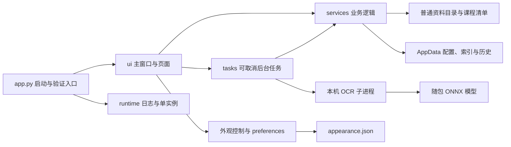
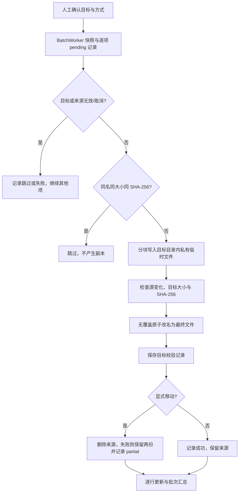

# CourseShelf 1.2.0 技术文档

此文为 1.2 存档。当前 1.3 的交互、分类和查询变化见 [WORKFLOW_UPDATE_1.3.md](WORKFLOW_UPDATE_1.3.md)。

文档日期：2026-10-20。适用版本：`v1.2.0`，程序源码提交：`0d6937968f32c1e3cf502b1df1dc86ab62ad1b82`。

本文描述已经实现并验证的行为，用于开发交接、维护和版本评估。历史需求草案中的标签、正文检索、云同步等功能不属于当前实现。界面专项记录见 [UI_REFRESH.md](UI_REFRESH.md)，M0–M7 历史验收见 [IMPROVEMENT_VALIDATION.md](IMPROVEMENT_VALIDATION.md)。

本次只修订技术说明；已发布的 v1.2.0 程序包保持原样，文档提交不改变上述程序源码基线或发布校验值。

## 1. 版本变化

### 1.1 相较于 1.1：重点是界面与个性化

1.2 将常用操作集中到单页工作区，增加主题与本机背景配置；归档、搜索、撤销和 OCR 的核心逻辑沿用 1.1。本次没有升级 OCR 模型，也没有新增联网分类服务。

| 项目 | 1.1.0 | 1.2.0 | 直接影响 |
| --- | --- | --- | --- |
| 页面结构 | 四个步骤标签页与右侧浏览区同时显示 | 侧边导航，每次显示一个工作页面 | 减少同屏信息与重复按钮 |
| 资料浏览 | 常驻右侧，空间有限 | 独立“资料库”，文件夹与文件横向排列 | 浏览、搜索获得完整工作区 |
| 启动页面 | 默认识别课表 | 有有效资料库时进入整理资料；首次使用进入课表与课程 | 日常整理不必先经过课表设置 |
| 收件箱 | 目标、理由、策略等控件展开显示 | 保留行内目标编辑，详情和进阶选项折叠 | 常用流程更短，完整路径仍可核对 |
| 执行按钮 | 位于归档页面内容中 | 执行区固定在底部 | 小窗口或展开详情时仍可执行、取消 |
| 拖放入口 | 来源输入区、目录树 | 另支持直接拖入收件箱表格 | 减少寻找入口的步骤 |
| 主题 | 固定浅色样式 | 暖纸、鼠尾草、雾蓝、夜墨四套主题 | 即时切换，支持深色工作环境 |
| 自定义背景 | 无 | 本机图片、可见度、移除、恢复默认 | 重启自动恢复外观 |
| 外观数据 | 无独立配置 | 新增 `appearance.json` | 切换资料库不会覆盖外观偏好 |
| 低频操作 | 分类管理、目录修复常驻 | 分类管理折叠；有缺失时才显示修复工具 | 降低初始界面密度 |
| 快捷搜索 | 聚焦右侧搜索框 | Ctrl+F 跳转资料库并聚焦搜索 | 适配独立页面结构 |
| 窗口尺寸 | 默认 1380×860，最小 1040×680 | 默认 1360×880，最小 1040×720 | 收件箱窄窗口自动调整列宽、隐藏大小列 |
| 卸载设置 | 可清除路径设置 | 可同时清除路径、主题、背景设置 | 原背景图片仍保留 |
| 本机单元/验收测试 | 27 项 | 32 项 | 新增 5 项外观与布局回归 |
| 未压缩发布目录 | 167.14 MiB | 167.16 MiB | 增加约 0.02 MiB |

比较依据：`git diff 0f654c8..0d69379`。运行依赖版本未因主题功能增加或改变；1.2 使用 PySide6 自带的 Fusion、QPalette、QSS、QPainter 和图片解码能力。

### 1.2 相较于最早的 v0.1.0：已形成完整整理流程

如果“之前”指最早的公开版本，则还包括 1.1 阶段完成的以下变化。这些能力在 1.2 中继续保留，但不是 1.2 单独新增：

| 最早公开版本的能力/局限 | 1.2 当前状态 |
| --- | --- |
| 单文件逐次整理 | 多文件、多文件夹收件箱，递归可选，逐项状态与失败重试 |
| 没有文件名搜索 | 可重建 SQLite 索引，按文件名、课程、分类搜索 |
| 没有持久操作历史与撤销 | 独立历史库，支持校验后的复制/移动撤销 |
| 同名主要靠加序号 | 同名同内容默认跳过；不同内容保留两个或跳过，禁止覆盖 |
| 没有用户课程别名 | 显式别名与保守模糊建议，歧义留给用户确认 |
| 课表识别重复初始化 | OCR 本地常驻进程、模型复用、预热与最近一图内存结果缓存 |
| 界面、文件逻辑集中 | `ui / tasks / services` 分层，保留根模块兼容入口 |
| 诊断与发布支持有限 | 轮转日志、单实例、取消生命周期、清单迁移、自动构建与 CI |
| 原发布目录基线约 384.37 MiB | 经过 1.1 的裁剪与压缩，1.2 为 167.16 MiB |

## 2. 产品边界与运行环境

CourseShelf 是单用户 Windows 桌面便携应用。核心流程为：课表识别或手工录入课程 → 核对 → 预览并创建目录 → 文件入箱 → 人工确认目标 → 批量归档 → 浏览、搜索和必要时撤销。

| 项目 | 当前实现 |
| --- | --- |
| 用户运行平台 | 64 位 Windows 10/11；完整解压后运行，无需另装 Python |
| 开发/构建环境 | CPython 3.12、PowerShell、本地虚拟环境 |
| 桌面框架 | PySide6 6.11.2 |
| OCR | RapidOCR 3.9.2、ONNX Runtime 1.30.0，随包本地模型 |
| 其他主要依赖 | Send2Trash 2.1.0、Pillow 12.3.0、OpenCV 4.11.0.86、NumPy 2.5.3 |
| 持久化 | JSON 配置/课程清单；SQLite 文件缓存与操作历史 |
| 打包 | PyInstaller 6.22.3；UPX 5.2.1 仅用于构建时压缩指定库 |
| 网络边界 | 应用功能离线；无账号、云接口、遥测、后台更新或运行时模型下载 |
| 构建时网络 | 首次安装依赖、准备 UPX、GitHub CI 和发布上传会联网 |
| 源码许可 | MIT；第三方依赖与模型的声明见 [THIRD_PARTY_NOTICES.md](THIRD_PARTY_NOTICES.md) |

## 3. 架构与模块职责



| 模块 | 责任与主要入口 |
| --- | --- |
| [app.py](app.py) | GUI 启动；离线 OCR、缓存、归档验证命令；导出旧 UI 导入兼容名 |
| [runtime.py](runtime.py) | 版本、Fusion/中文字体/图标初始化、日志、异常钩子、QLockFile、系统打开封装 |
| [ui/main_window.py](ui/main_window.py) | 主窗口、侧栏导航、固定资料路径区、页面装配与启动页面选择 |
| [ui/tabs](ui/tabs) | OCR、建目录、归档、资料库、历史各自的界面控制器 |
| [ui/widgets.py](ui/widgets.py) | 本地拖放、收件箱表格、窄窗口适配、折叠区域、主题化下拉控件 |
| [ui/appearance.py](ui/appearance.py) | 主题预览、背景选择/解码/绘制、外观面板及合并保存 |
| [ui/style.py](ui/style.py) | 四套颜色令牌和统一 QSS |
| [tasks/worker.py](tasks/worker.py) | 归档、索引、目录读取、计数、撤销、文件及分类操作的任务封装 |
| [tasks/ocr.py](tasks/ocr.py) | OCR 阶段信号与取消桥接 |
| [services/catalog.py](services/catalog.py) | 受管课程/分类、清单迁移、目录创建/修复、分类安全操作 |
| [services/classifier.py](services/classifier.py)、[inbox.py](services/inbox.py) | 文件名建议和入箱；不执行归档写入 |
| [services/file_ops.py](services/file_ops.py) | 分块复制、校验、临时文件、无覆盖提交与移动删源 |
| [services/library_index.py](services/library_index.py) | 可重建文件索引、扫描与搜索 |
| [services/history.py](services/history.py) | 持久操作记录、受管文件判定、安全撤销 |
| [services/organizer.py](services/organizer.py)、[ocr_process.py](services/ocr_process.py) | 路径设置、课程名清洗、OCR 模型/结果缓存及子进程通信 |
| [services/browser.py](services/browser.py) | 本机路径判定和目录快照 |
| [services/preferences.py](services/preferences.py) | 外观偏好规范化与独立 JSON 读写 |
| [uninstaller.py](uninstaller.py) | 只删除清单中校验匹配的程序文件；保留资料和原背景图片 |

根目录 `catalog.py / organizer.py / file_ops.py / classifier.py / inbox.py / library_index.py / history.py / dialogs.py` 是兼容导入入口，实际业务实现在分层模块中。

## 4. 界面与个性化设计

### 4.1 页面组织

视觉顺序为整理资料、资料库、课表与课程、生成目录、操作记录。内部仍使用 `QTabWidget`，隐藏原生标签条，由侧栏控制页面；原内部索引保留：OCR=0、生成=1、归档=2、历史=3、资料库=4。

资料路径在所有页面顶部显示。已保存且存在的资料库启动后进入归档页；首次使用进入课程准备页。目录失效时提示并要求重新选择，不自动建立替代空目录。

收件箱保持七列数据模型，匹配理由列默认隐藏。表格视口小于 850px 时隐藏大小列并收窄目标列；“选中项详情与进阶选项”保留完整来源、目标及策略。固定底部执行区与详情展开按钮独立于上方滚动内容。

### 4.2 主题令牌

| 标识 | 名称 | 背景 | 工作面板 | 文字 | 强调色 |
| --- | --- | --- | --- | --- | --- |
| `paper` | 暖纸（默认） | `#F5F2EB` | `#FFFDFA` | `#35433D` | `#566E5E` |
| `sage` | 鼠尾草 | `#EDF2EC` | `#FAFCF8` | `#33483B` | `#526F54` |
| `mist` | 雾蓝 | `#EDF2F5` | `#FAFCFD` | `#344752` | `#4D7183` |
| `ink` | 夜墨 | `#202725` | `#29312E` | `#E2E7DF` | `#B1C6A6` |

颜色由 QPalette 与 QSS 同时应用，覆盖文字、输入框、选择状态、菜单和提示。正文为微软雅黑 13px、页面标题 27px；侧栏固定宽 194px。当前不提供跟随系统主题、自定义颜色编辑或定时切换。

### 4.3 背景图生命周期

1. 用户在右上角“外观与背景”选择本机 PNG/JPG/JPEG/BMP；不接受网页地址。
2. 文件上限 30 MiB；拒绝无效尺寸或超过 100,000,000 像素的输入。
3. 使用 `QImageReader` 自动处理图片方向；大图请求按最长边 2048 缩小解码，不改原图。
4. `BackgroundCanvas` 按比例铺满并居中裁切，缓存当前窗口尺寸的缩放图，避免每次绘制重复缩放。
5. 可见度范围为 0–80%，默认 35%；工作面板保持实色以保证文字可读。
6. 保存的只是原图绝对路径；图片不复制到资料目录、AppData 或发布包。
7. 选择错误图片时保留原设置；下次启动发现原图丢失/损坏时回退为主题底色并提示。更换原路径上的图片后如需刷新，应先移除背景再选择，或重启。

外观即时预览，250ms 合并写入；关闭外观面板或关闭主窗口时刷新待保存偏好。“恢复默认外观”仅恢复 `paper / 空背景 / 35%`，不改资料路径和文件。

## 5. 数据模型与存放位置

### 5.1 磁盘是事实源

```text
用户选择的资料总目录/
├─ .courseshelf.json
├─ .courseshelf.json.bak
└─ 学期/课程/分类/原格式文件

%LOCALAPPDATA%/CourseShelf/
├─ settings.json
├─ appearance.json
├─ index.db
├─ history.db
├─ app.lock
└─ logs/app.log（及轮转备份）
```

资料根目录必须是已有本机普通目录；界面拒绝符号链接、目录联接、UNC 和映射网络盘根目录。默认分类为课件、作业、复习资料、其他；分类与顺序可以按课程管理。

### 5.2 JSON 配置

`settings.json`：

```json
{"root": "D:\\学习资料", "last_viewed": "D:\\学习资料\\2026秋季\\示例课程\\课件"}
```

`appearance.json`：

```json
{"theme": "paper", "background": "D:\\图片\\背景.jpg", "visibility": 35}
```

未知主题回退为 `paper`；可见度规范化到有效整数范围；损坏外观配置按默认值加载。外观保存使用同目录临时文件、flush/fsync 后原子替换，与资料路径保存分开。

`.courseshelf.json`：

```json
{
  "schema_version": 2,
  "courses": {
    "2026秋季/示例课程": {
      "categories": ["课件", "作业", "复习资料", "其他"],
      "aliases": ["示例课"]
    }
  }
}
```

课程清单保存受管关系、分类顺序和显式别名，不保存文件正文。v1→v2 迁移为课程补充可选别名并备份原清单；读取高版本、损坏清单或迁移失败时保留原件并禁用资料写入，仍可浏览磁盘。缺失清单不删除磁盘文件，但不能凭目录存在恢复原顺序、别名和受管关系。

### 5.3 索引数据库 `index.db`

`PRAGMA user_version=1`，核心表为 `file_record`：

| 字段 | 用途 |
| --- | --- |
| `id` | 主键 |
| `library`、`rel_path` | 资料根目录标识与相对路径，组合唯一 |
| `name`、`ext` | 文件名、扩展名 |
| `size`、`mtime_ns` | 增量扫描变化判定 |
| `sha256` | 可空缓存字段；大小/mtime 变化后清空，不做全库哈希预计算 |
| `course`、`category` | 从目录层级推导的检索字段 |
| `status`、`seen_at` | 当前扫描可见性及扫描时间；未出现项标记 missing |

搜索使用转义后的 SQLite `LIKE`，支持文件名、课程、分类筛选，默认最多 500 项。打开结果前/返回搜索时检查实际文件存在性；数据库记录不替代磁盘事实。扫描遇错或取消时回滚本次事务，不把未完成扫描误判为全库缺失。

关闭软件后可删除索引，下次启动会后台重建。损坏、未知版本或结构不完整的缓存移存为 `index.broken-<UUID>.db` 后重建，不借此删除用户资料。

### 5.4 历史数据库 `history.db`

`PRAGMA user_version=1`，独立持久表 `operation`：

| 字段组 | 字段 |
| --- | --- |
| 身份与分组 | `id`、`library`、`batch_id` |
| 操作 | `kind`：copy、move、mkdir、trash、rename、undo |
| 路径 | `src`、`dst`：绝对路径 |
| 校验 | `size`、`sha256` |
| 结果 | `result`：pending、ok、failed、skipped、partial；`error` |
| 时间与关联 | `ts`（纳秒时间戳）、`undo_of` |

历史按批次展示，默认读取最近 500 条记录；可查看本机所有资料目录的历史。历史不可通过扫描重建，因此与可删除的索引分库。资料目录搬移或换机器后不会自动重写旧路径或转移撤销依据。未知历史版本保持原数据库并拒绝不兼容写入。

### 5.5 兼容与保留策略

旧 `%LOCALAPPDATA%/FilesOrganizerDemo` 存在而新路径设置不存在时，首次兼容复制 settings、index、history，保留旧文件。测试可用 `FILES_ORGANIZER_CONFIG_DIR` 隔离整个应用配置目录。

卸载时，用户可以明确清除路径与外观设置；操作历史、日志、原背景图和用户资料保留。清除索引不影响历史；删除历史会丢失撤销和文件受管判定依据，不能视为普通缓存清理。

## 6. 业务流程与安全机制

### 6.1 入箱与建议

`build_inbox()` 接收多个文件/文件夹，默认只展开直接子文件，递归需要勾选；不遍历链接目录。`InboxItem` 保存来源、大小、人工目标、建议目标、模式、理由、状态、错误与实际结果路径，建议与最终选择分开。

课程建议顺序为全名 → 显式用户别名 → 保守模糊匹配。全名竞争优先最长唯一命中；共享别名、跨学期同名或近似竞争不能自动选课。模糊候选为低置信，仍需手动确认。分类使用文件名关键词，可建议“其他”，但不能因此替用户选择一个未知课程。

高置信建议只有点击应用或人工选择后才成为目标；点击执行前不会因为建议而复制、移动文件。没有唯一目标的行跳过并提示需手选。

### 6.2 批量归档



文件按 1 MiB 分块处理。临时文件名为 `.courseshelf-partial-<UUID>`，使用独占创建；写完 flush/fsync，核验源大小/mtime 及目标大小/SHA-256，再提交最终名称。Windows 同目录 `os.rename` 遇到现有目标时失败，保留两个策略改用 `(1)`、`(2)` 等名称重试；没有覆盖分支。

默认复制。同名策略为保留两个或跳过；默认策略下，同名同内容仍会优先去重跳过。移动必须显式选择；批量任务拒绝把资料总目录内的原有文件作为移动来源。移动删源失败时目标和来源均保留，明确报告部分成功。

每项失败独立报告，不中断整个批次。取消在任务检查点生效；已完成项保留，未完成项来源不变，未提交临时文件清理。成功项不会在下一次执行中自动重复归档；失败项通过重试入口处理。

文件系统与 SQLite 没有跨系统事务：先建立 pending 记录，提交目标时保存校验信息，随后更新最终结果。历史写入失败时保留成功文件并报告；不能承诺崩溃后自动回滚整个批次，也不能将数据库失败作为删除已提交目标的理由。

### 6.3 撤销及受管文件保护

| 操作 | 必要条件与结果 |
| --- | --- |
| 撤销复制 | 成功历史、目标仍在根目录内、非链接、大小与 SHA-256 匹配且校验期间未变；目标送回收站，来源保留 |
| 撤销移动 | 同样校验目标；原来源目录存在且原路径空闲；按校验移动流程恢复，禁止覆盖 |
| 目标内容已改或已撤销 | 拒绝并说明原因 |
| 单文件重命名/回收 | 只能操作本应用有成功归档/重命名记录且内容仍一致的文件 |
| 分类整体重命名/回收 | 分类明确受管，后台逐文件核对受管记录、大小、哈希；未登记、内容已改或链接对象阻止整目录操作 |
| 重建缺失目录 | 仅重建已登记的空目录，不恢复文件内容 |
| 回收后的分类恢复 | 用户在 Windows 回收站手动恢复；不提供自动分类还原 |

所有资料删除走回收站；无永久删除回退。默认拒绝危险确认（No/取消），Return 不触发删除。把课程纳入管理不会自动赋予其既有文件的修改权限。

## 7. OCR 与后台任务

### 7.1 本机 OCR 服务

模型为 `PP-OCRv6_det_small.onnx`、`ch_ppocr_mobile_v2.0_cls_mobile.onnx`、`PP-OCRv6_rec_small.onnx`。启动时按本地路径检查，缺失即报错，不联网补下载。

OCR 使用本机子进程，主进程通过 stdin JSON 行发出请求，通过系统临时目录内的阶段/结果文件接收反馈。结果文件使用临时写入后替换；任务正常结束会清理临时目录。模型在子进程内复用；取消会终止该进程，下次请求再创建。界面空闲时进行模型预热，显示加载、检测识别、整理等阶段文字。

最近一张图片的结果只驻留内存，签名包含规范路径、大小、mtime_ns 与内容 SHA-256；相同签名复用结果，内容改变则重新推理。缓存加速不代表新图片的识别速度或准确率提升。OCR 请求期间会使用临时结果文件，不能将“没有永久保存到 AppData”理解为“全过程绝不落临时文件”。

课程提取以清晰汇总表为主，支持课程名称/课程名/科目/课程、课程代码/课程编号/编号、课程类别/类型/类别等表头同义词。用户必须核对候选，再创建目录。

### 7.2 线程与窗口生命周期

后台任务共享 `TaskWorker(QThread)` 的取消标志及进度/错误/逐项信号。主要任务包括 BatchWorker、ScanWorker、DirectoryWorker、CountWorker、UndoWorker、FileActionWorker、CategoryWorker 和 OCR worker。

目录树按展开懒加载，无固定三层上限；超过小目录快速快照范围时使用后台枚举，UI 每批填充 64 行。单次刷新缓存课程清单，避免级联重复读盘；查看位置使用 350ms 合并保存。并非所有函数都异步：小目录快照、目录生成与部分轻量管理逻辑仍会同步执行。

关闭窗口时取消索引、目录读取及预热任务；业务任务运行时询问是否取消后退出，等待线程完成信号后再关闭，避免销毁仍在运行的 QThread。文件写入、撤销和分类修改之间有并发操作限制。

## 8. 诊断、恢复与隐私

轮转日志位于 `logs/app.log`，单文件 5 MiB、3 个备份，记录版本、环境及操作结果。`sys.excepthook`、`threading.excepthook` 和任务异常报告接到可复制详情的界面。日志可能包含本地路径和文件名，只写本机，不自动上报。

同一配置目录使用 QLockFile 保持单实例；重复启动提示并尝试激活已有窗口。系统打开失败会显示中文错误并记日志，不能因外部文件消失而静默崩溃。

索引可重建、操作历史须保留、课程清单须备份，是三种不同恢复策略。程序卸载只删除发布 manifest 中 SHA-256 匹配的程序文件及其可清理空父目录，改动过的程序文件、未登记资料及用户新建空目录保留；卸载器自身与 manifest 使用退出后的专用清理流程，不递归删除用户目录。

## 9. 构建、发布与升级

### 9.1 源码运行和验证

在项目根目录的 PowerShell 中执行：

```powershell
py -3.12 -m venv .venv
.\.venv\Scripts\python.exe -m pip install -r requirements-dev.txt
.\tools\setup_upx.ps1
.\.venv\Scripts\python.exe app.py

# 完整流程：语法 → 单元 → 离线冒烟 → 构建 → 搬移后验收
.\tests\verify_milestone.ps1 -Milestone local
.\.venv\Scripts\python.exe -m ruff check .
.\.venv\Scripts\python.exe -m mypy --ignore-missing-imports .

# 只构建，或生成虚构资料的 UI 预览
.\build.ps1
.\.venv\Scripts\python.exe tools\preview_ui.py
```

UPX 工具下载有固定版本和 SHA-256 校验，可通过 `-Proxy` 参数配置构建代理；不属于应用运行时联网。测试写操作只发生在系统临时目录或程序的临时副本，课表样本为虚构数据。

构建使用 onedir/windowed，保留 QtCore/Gui/Widgets 及必要插件，裁剪未用 Qt 模块、翻译、视频库与重复文件；仅压缩已验收的 cv2/OpenBLAS，Qt、Python、ONNX 运行库不强制压缩。自动生成图标、版本资源、第三方许可证目录、release-manifest 和版本化 zip。脚本把 180 MiB 作为发布目录上限。

构建流程可重复执行，但含构建时间和平台打包信息，不承诺不同机器/时间生成逐字节相同的 zip。只有当前发布资产使用下述固定校验值。

### 9.2 当前发布资产

| 项目 | 结果 |
| --- | --- |
| 版本与源码 | `v1.2.0` / `0d69379` |
| 解压后程序目录 | 175,280,528 bytes，167.16 MiB |
| Windows zip | 104,532,028 bytes，99.69 MiB |
| 本机位置 | `dist/CourseShelf-1.2.0-Windows.zip` |
| 程序入口 | `dist/CourseShelf/CourseShelf.exe` |
| manifest 记录 | 246 个程序文件；zip 共 248 个文件（另含 manifest 与卸载器） |
| 数字签名 | 未签名 |

zip SHA-256：

```text
e36c9d3bae3ad0d1de9924c757ba3f397ecdf563d8acca60807fe72ea78b03cf
```

[GitHub 发布页](https://github.com/lntanovo/CourseShelf/releases/tag/v1.2.0)提供 Windows zip 和校验文件。给朋友分享完整 zip，完整解压后运行 `CourseShelf/CourseShelf.exe`，不单独发送 exe，不把用户的资料目录、AppData 或背景原图一起打包。

### 9.3 升级兼容

关闭旧程序，将新版本完整解压到新的程序文件夹运行。资料根目录与 AppData 独立于程序目录，同一电脑上的资料路径、清单、索引和历史可继续使用；1.1→1.2 不升级课程清单和数据库版本，新增外观配置缺失时使用默认主题。

便携程序可以换路径，资料目录和历史不是同一迁移对象：单独把程序发到另一台电脑，不会携带原用户的资料、路径或历史；新电脑需要自行选资料库，撤销依据不随普通资料文件夹自动搬迁。

## 10. 验证结果与证据边界

以下为 1.2 实施时已执行记录，文档更新本身不重新声明一轮产品测试：

| 验证项目 | 已观察结果 |
| --- | --- |
| 本机全部单元/回归 | 32/32，通过；末次 16.950s |
| 外观新增覆盖 | 5 项：持久化、四主题、图片错误/丢失、恢复默认、窄窗口/拖放/移除 |
| 代码检查 | ruff 通过；宽松 mypy 检查 45 个文件通过 |
| 离线 OCR 冒烟 | 虚构课表 9/9，socket 网络拦截开启 |
| 目录生成 | 46 个首次建立，重复执行全部复用 |
| 5000 文件响应 | 本机末次最大事件循环间隔 19.8ms，测试阈值 200ms |
| 缓存耗时示例 | 本机相同图片 3.112s→0.047s；打包后 4.616s→0.048s，仅说明结果缓存命中 |
| 搬移后 exe | 离线 OCR、复制保源、GUI 存活、清单卸载与用户文件保护通过 |
| 外观卸载 | 测试配置主题/背景后启动；清除偏好，背景原图哈希不变 |
| 发布资产 | zip CRC、manifest 各文件 SHA-256、上传大小及 GitHub 资产摘要匹配；公开下载 HTTP 200 |
| GitHub Windows CI | `0d69379` 的 main 推送与 v1.2.0 标签触发两次运行，均已成功 |

CI 结果分别见 [main 运行](https://github.com/lntanovo/CourseShelf/actions/runs/39290755586) 与 [标签运行](https://github.com/lntanovo/CourseShelf/actions/runs/39291251867)，状态于 2026-10-20 核实。上一版的 Windows 测试短路径/长路径混用已通过规范化临时测试根目录修复，未放宽路径安全检查。

本机原始日志在 `artifacts/improvement/ui-refresh-*.log`、`ui-final-unit.log`、`ui-ruff.log`、`ui-mypy.log`、`ui-artifact.log`；仅本机保存，不保证包含在源码下载包。截图脚本覆盖四主题、背景面板及两档窗口，使用虚构文件，不含私人课表。

GitHub runner 上的独立构建和搬移通过，不能替代已发布 zip 在所有朋友电脑上的人工兼容测试。mypy 当前不检查未注解函数体，UI/tests 允许错误，不能表述为严格全量类型验证。性能数字是指定样本和环境的观测，不是所有设备的承诺。

## 11. 已知限制与后续评估

- OCR 对清晰汇总表更可靠；未实现通用格子周课表识别、手动框选、可靠逐课程置信度，未用非汇总表真实课表完成验证。
- 搜索仅覆盖文件名及课程/分类元数据；没有正文检索、标签系统或本地文档预览。
- 去重只在同名冲突时比较内容，不提供不同文件名的全库重复文件查找。
- 没有自动监控下载目录、自动永久学习规则、账号、同步或在线资料分享。
- 不支持撤销建目录、分类重命名、文件重命名、回收本身或撤销操作本身；回收站操作由系统手动还原。
- 历史路径与文件身份校验严格；外部移动文件或资料根目录后可能无法继续撤销旧记录。
- 主题是四套预设；没有自定义主题编辑器或系统主题自动跟随；背景原图移走后不会自动复制恢复。
- 未提供安装向导和代码签名。当前为 Windows 便携版，未完成 macOS/Linux 产品验收。

后续功能须另行明确需求和验收，不能因本文件列出限制而默认纳入开发范围。
